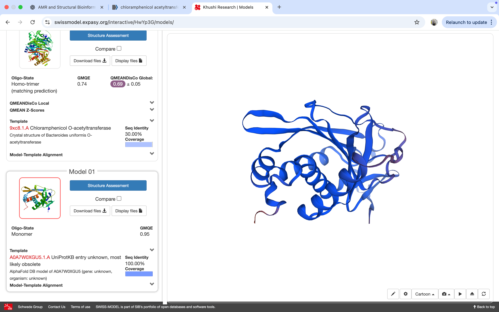
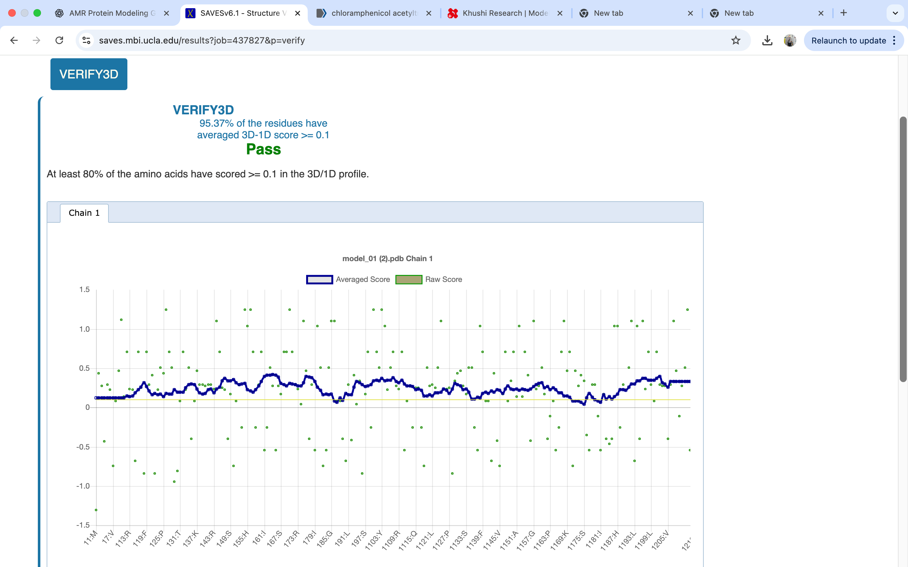
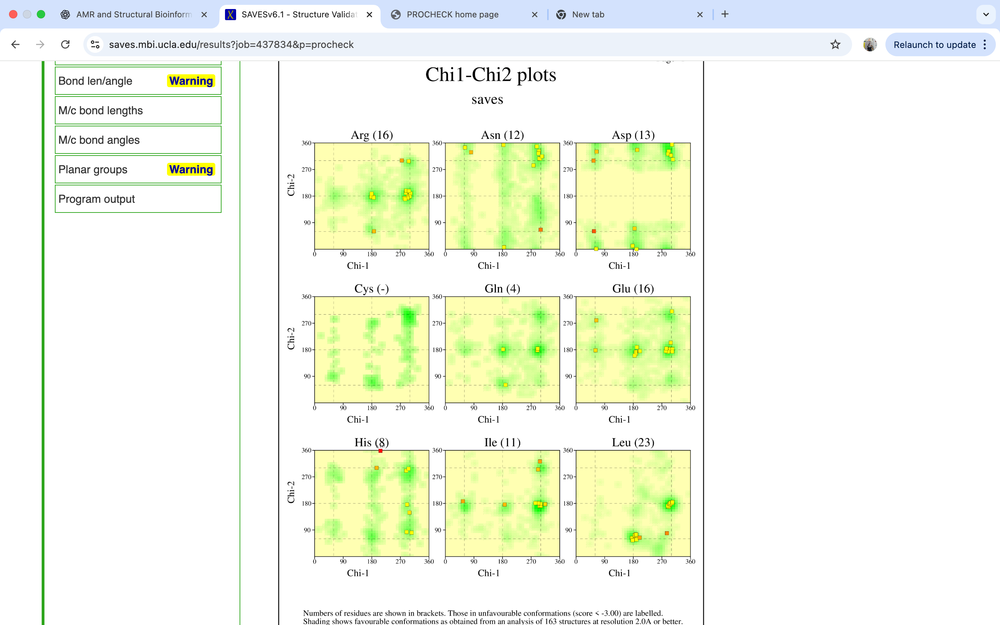
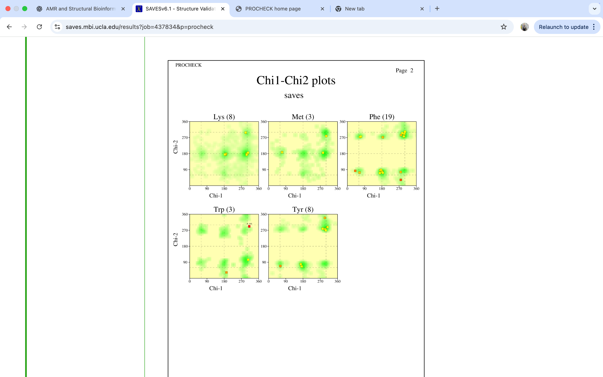
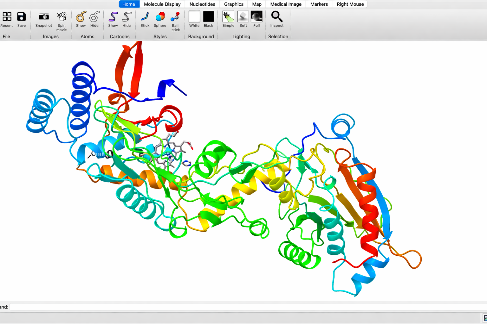

# AI-Powered Structural Bioinformatics for Antimicrobial Resistance

**Predicting Tomorrow's Resistance Today: AI-Powered Structural Bioinformatics for Precision Antimicrobial Drug Design**

Authors: Khushi Sharma, Dr. Aruna Rani
Department of Biotechnology, IILM University, Greater Noida, Uttar Pradesh, India

This repository holds the work from two research posters on modeling antibiotic-resistance enzymes and a proposed AI framework for forecasting resistance mutations.

## Background

Antimicrobial resistance (AMR) is a major global health problem. Enzymes such as Chloramphenicol Acetyltransferase (CAT) and MCR-1 inactivate key antibiotics, and resistance is usually identified only after it appears in the clinic. This project combines structural bioinformatics with AI to model resistance proteins and to propose a way to forecast resistance mutations earlier.

## Objectives

1. Model and analyze the structure and function of resistance enzymes (CAT, MCR-1).
2. Integrate structural bioinformatics and AI into a cloud-based framework for early forecasting of resistance-conferring mutations.
3. Support precision antimicrobial drug design and reduce therapeutic failures.

## Methods

| Step | Tool / Source |
|---|---|
| Sequence retrieval | NCBI (CAN5826733.1) |
| Homology modeling | SWISS-MODEL |
| Structure validation | Verify3D, PROCHECK (Ramachandran and Chi1-Chi2 plots) |

The proposed pipeline runs from target selection and sequence retrieval through homology modeling, validation, mutation analysis and docking to AI-based forecasting.

## Results

- CAT 3D structure predicted with SWISS-MODEL.
- Verify3D validation passed.
- PROCHECK analysis showed favorable residue geometry.
- The model was considered reliable for further analysis.

| SWISS-MODEL structure | Verify3D |
|---|---|
|  |  |

| PROCHECK Chi1-Chi2 (A) | PROCHECK Chi1-Chi2 (B) |
|---|---|
|  |  |

## Proposed framework (hypothesis)

A cloud-based AI platform: data processing, structural modeling, structure validation, mutation dataset integration, AI-based resistance forecasting, and risk scoring with early warnings. An AI-guided nanoplatform (silver nanoparticles, liposomes, PLGA, chitosan carriers) is proposed for mutation-informed drug delivery.

> The stability and Bayesian-update curves in Poster 2 (Fig. 3) are illustrative expected outcomes, not experimental results.

## Posters

| Poster | File |
|---|---|
| 1. Predicting Tomorrow's Resistance Today (structural analysis) | [PDF](poster1_bennett_structural-analysis.pdf) |
| 2. Predictive Cloud-Based AI for Preclinical Forecasting of AMR Mutations | [PDF](poster2_conference2026_predictive-ai.pdf) |

## Future work

- AI-based mutation forecasting
- Docking and binding-affinity comparison
- Rational drug design against resistance enzymes

## References

1. Sadhukhan, S., et al. (2025). Artificial intelligence in protein-based detection and inhibition of AMR pathways. *Journal of Computer-Aided Molecular Design*, 40(1), 4. https://doi.org/10.1007/s10822-025-00710-4
2. Arango-Argoty, G., et al. (2018). DeepARG: A deep learning approach for predicting antibiotic resistance genes from metagenomic data. *Microbiome*, 6, 23. https://doi.org/10.1186/s40168-018-0401-z

## Contact

Khushi Sharma: khushi.sharma.bi28@iilm.edu
Dr. Aruna Rani: aruna.rani@iilm.edu
